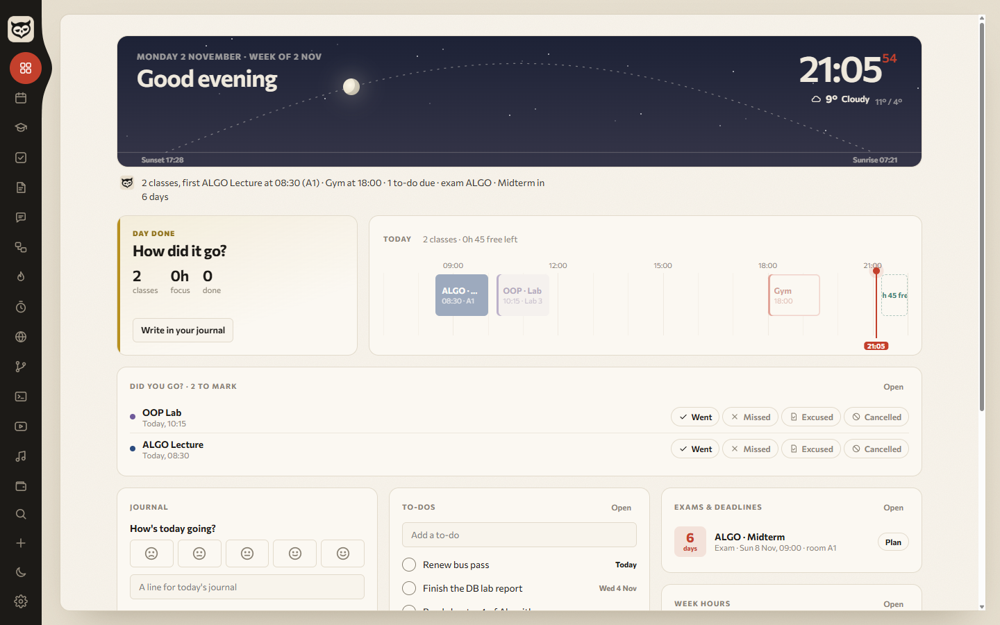
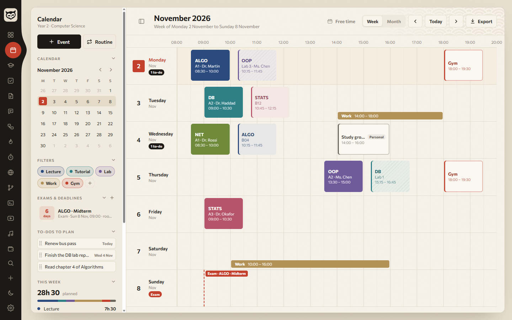
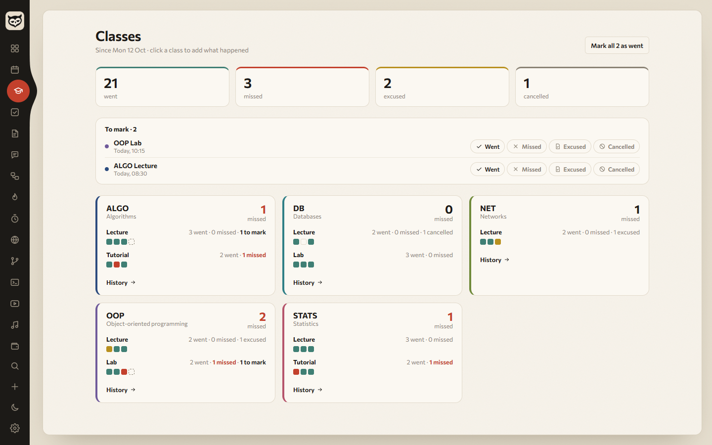
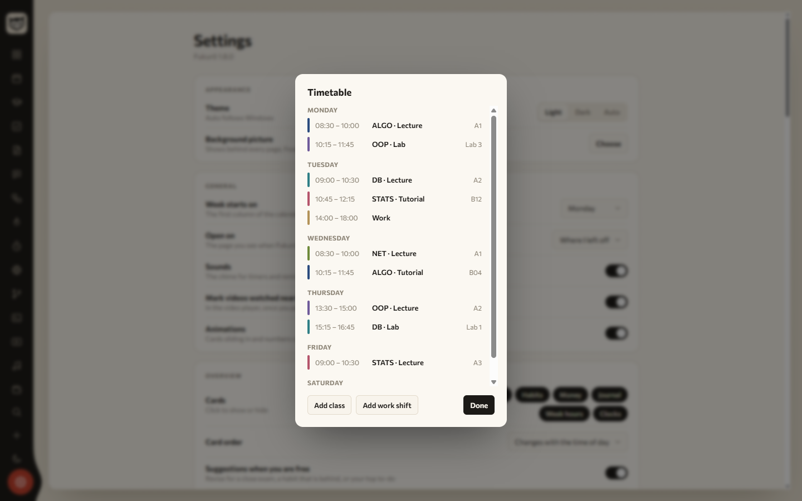
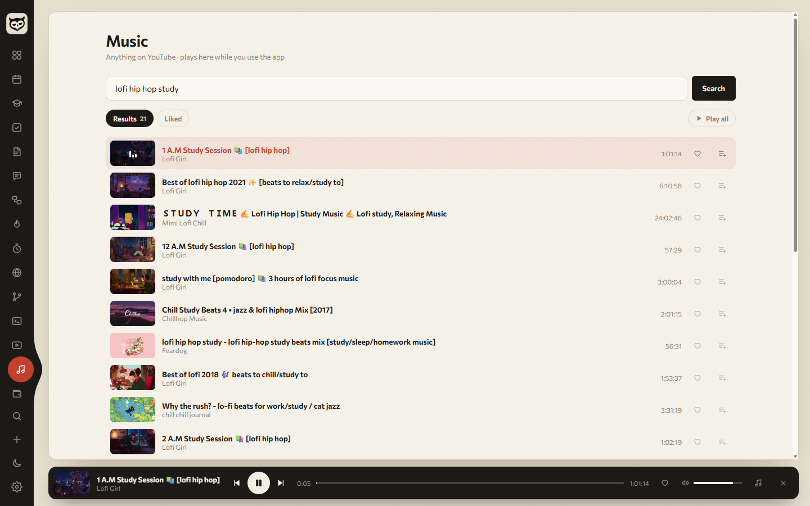
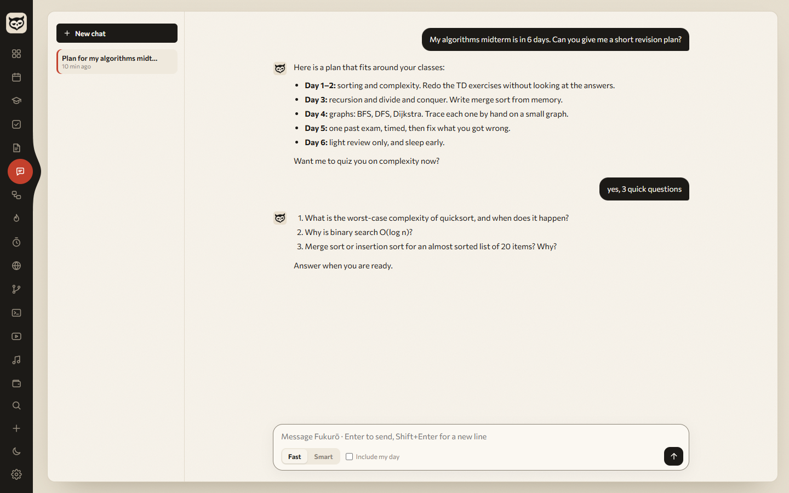

# Fukurō 梟

A calm desktop hub for your week. Your timetable, calendar, to-dos, notes, budget, habits and focus timer live in one window, and your data stays on your own PC.

**[Download for Windows](https://github.com/k4zmx/Fukuro/releases/latest/download/Fukuro-Setup.exe)** · free · made by [Crino Studio](https://crinostudio.com)



## Install

1. Download **[Fukuro-Setup.exe](https://github.com/k4zmx/Fukuro/releases/latest/download/Fukuro-Setup.exe)** (always the newest version) and run it.
2. The installer isn't code-signed yet, so Windows SmartScreen may warn you the first time. Click **More info → Run anyway**.
3. That's it. Fukurō checks for new versions on its own and offers **Restart to update**.

Windows 10 and 11. Older versions and release notes are on the [releases page](https://github.com/k4zmx/Fukuro/releases).

## What's inside

| | |
|---|---|
| **Overview** | Your day at a glance: a sky that follows the real sun, weather, what's on now, free time left, focus, habits, money |
| **Calendar** | Week and month views. Drag to move or resize, one-off or weekly events, filters, free-time finder, print / .ics export |
| **Timetable** | Your weekly classes and work shifts, entered once. Groups, room, teacher. Share it with classmates as a file |
| **Classes** | After each class Fukurō asks "Did you go?". One click: went, missed, excused or cancelled, with a note if you want. See your counts per subject |
| **Exams & deadlines** | Countdown and a revision planner that books sessions into your free time |
| **To-dos** | Due dates, drag a to-do onto the calendar to block time for it |
| **Notes** | Real `.md` files on disk: lists, tables, pictures, `[[links]]` with backlinks, daily journal |
| **Budget** | Cash and account balances, monthly salary and bills, category limits, savings goals, insights |
| **Videos** | Save lectures and tutorials, watch them inside the app, pick up where you stopped |
| **Music** | Search anything on YouTube and listen while you work. Like songs, queue them, use your keyboard's media keys |
| **Chat** | Ask Claude anything, right in the app (optional, see below) |
| **Also** | Boards, habits, projects (git status), snippets, world clocks, focus timer, Ctrl+P search, quick capture from anywhere (Ctrl+Shift+Space) |





## Getting started

The first launch asks for three things: the day your week starts on, your city (for weather and sunrise) and your currency. Everything can be changed later in **Settings**.

To add your classes, go to **Settings → Timetable → Add**, or open the calendar, click a class, then **Edit class**. If a classmate already did the work, use **Import…** with the file they exported.

Turn on **Settings → Desktop → Start with Windows** so the "Did you go?" check-ins and reminders reach you.



## Music



Music plays YouTube audio through [yt-dlp](https://github.com/yt-dlp/yt-dlp). It isn't in the installer: the first search downloads it (about 18 MB, once) and Fukurō keeps it up to date. Songs are streamed, not saved.

## AI features (optional)



Chat, smart quick capture and the weekly review run on **your own** [Claude Code](https://claude.com/claude-code) sign-in. Fukurō has no AI account or API key of its own. If Claude Code isn't installed and signed in, these features stay off and everything else works the same.

- **Chat**: Fast (Haiku) or Smart (Sonnet). "Include my day" is off unless you tick it.
- **Quick capture**: type "dentist Thursday 3pm" and it lands on the calendar. Simple notes never leave your PC.
- **Weekly review**: once a week, a short summary of your week saved to your notes. Can be turned off in Settings.

## Your data

- Everything except notes is stored in `Documents\Fukurō\data.json`. If your Documents folder is in OneDrive, that file follows you to your other PCs.
- Notes are plain `.md` files in `Documents\Fukurō\Notes`. You can pick another folder in Settings.
- **Settings → Your data → Export** saves everything to a single file.

Fukurō has no account and no tracking. The only things that go online are:
- the weather: your city's coordinates are sent to [Open-Meteo](https://open-meteo.com);
- YouTube: titles for links you save, videos you play, music you search for and play;
- the AI features, only when you use them, through your Claude Code;
- the update check against GitHub.

## Build from source

You need [Node.js](https://nodejs.org) 20 or newer.

```bash
git clone https://github.com/k4zmx/Fukuro.git
cd Fukuro
npm install
npm start           # run it
npm run dist        # build the Windows installer into dist/
```

The app is plain HTML, CSS and JavaScript with no build step, wrapped in Electron. The scripts share one global scope, so run `npm run check` after changes: it catches two files declaring the same name.

To publish a release, bump `version` in `package.json`, then run `npm run release`. It needs a GitHub token in `GH_TOKEN`, or the one git already uses for github.com.

## License

[MIT](LICENSE). The bundled [Commissioner](https://github.com/kosbarts/Commissioner) font is under the SIL Open Font License.
