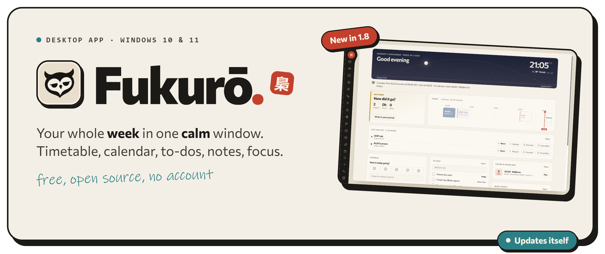

<p align="center">
  
</p>

<p align="center">
  <a href="https://github.com/k4zmx/Fukuro/releases/latest/download/Fukuro-Setup.exe"></a>
</p>

<p align="center">
  <a href="https://crinostudio.com/fukuro#trailer"></a>
  <br><sub><a href="https://crinostudio.com/fukuro#trailer">Watch the full trailer with sound</a></sub>
</p>

## Install

1. Download **[Fukuro-Setup.exe](https://github.com/k4zmx/Fukuro/releases/latest/download/Fukuro-Setup.exe)** and run it.
2. If Windows says it protected your PC, click **More info → Run anyway**. The app isn't code-signed yet, that's all it means.
3. Done. Fukurō updates itself when a new version is out.

Windows 10 and 11. Release notes are on the [releases page](https://github.com/k4zmx/Fukuro/releases).

## What's inside

Calendar · timetable · class check-ins · exams and revision planner · to-dos · notes · budget · habits · focus timer · videos · music · chat

<p align="center">
  
</p>

<details>
<summary><b>What goes online</b></summary>

- **Weather**: your city's coordinates go to [Open-Meteo](https://open-meteo.com).
- **Music and videos**: YouTube, through [yt-dlp](https://github.com/yt-dlp/yt-dlp) (downloaded once on first use). Songs are streamed, not saved.
- **AI** (chat, smart quick capture, weekly review): optional, and only through **your own** [Claude Code](https://claude.com/claude-code) sign-in. Without it, everything else works the same.
- **Updates**: a check against this repo's releases.

</details>

<details>
<summary><b>Build from source</b></summary>

Needs [Node.js](https://nodejs.org) 20+.

```bash
git clone https://github.com/k4zmx/Fukuro.git
cd Fukuro
npm install
npm start          # run it
npm run dist       # build the installer into dist/
```

Plain HTML, CSS and JavaScript in Electron, no build step. The scripts share one global scope, so run `npm run check` after changes.

</details>

<p align="center">
  <a href="https://crinostudio.com"></a>
</p>

<p align="center"><sub><a href="LICENSE">MIT</a> · The bundled <a href="https://github.com/kosbarts/Commissioner">Commissioner</a> font is under the SIL Open Font License.</sub></p>
